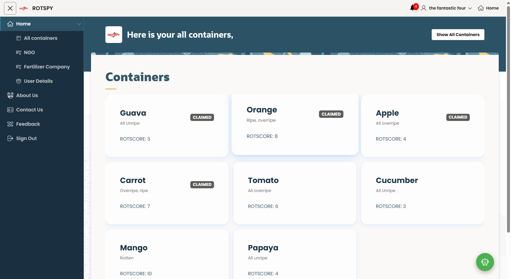
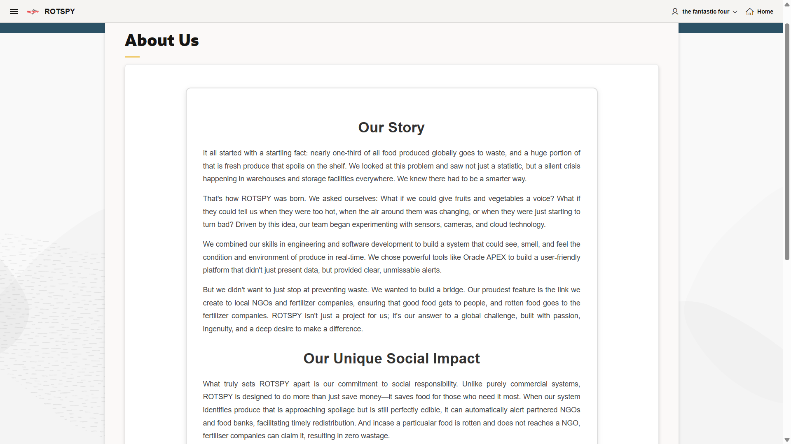
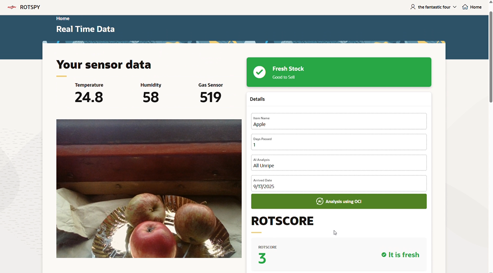
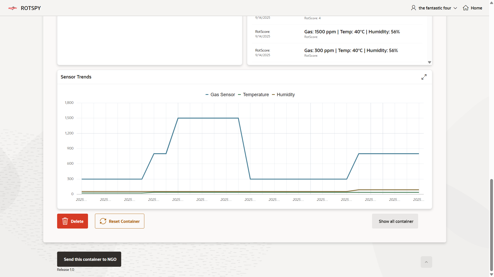
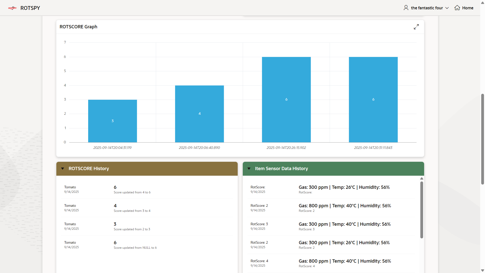
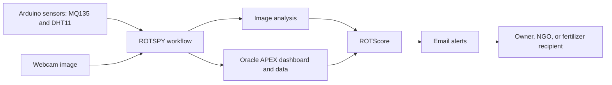

# ROTSPY

**Oracle APEX and IoT produce monitoring system**

ROTSPY is a hackathon prototype that combines environmental sensor readings and webcam based image analysis to help track produce freshness. The project was built by **The Infinity Coders** for INOAUG Xcelerate 2025.

[Watch the ROTSPY demo video on LinkedIn](https://lnkd.in/p/geaZs_vM)

## The problem

Produce can spoil between manual inspections. ROTSPY explores a monitoring workflow that combines sensor data and image analysis to help identify produce that is fresh, nearing spoilage, or spoiled, then route it for sale, donation, or recycling.

## How it works

1. Arduino connected sensors collect gas, temperature, and humidity readings.
2. A webcam captures produce images for image analysis.
3. Oracle APEX provides the dashboard and coordinates data and status updates.
4. The system calculates a ROTScore and sends email alerts that support the recipient workflow.

The screenshots show status labels that vary between views. Confirm the final score-to-status rules before relying on exact thresholds.

## Screenshots

### Container overview

### About the project

### Live sensor data

### Sensor trends

### ROTScore history

### Freshness notifications

## System overview

## Technologies

- Oracle APEX
- PL/SQL and JavaScript
- REST APIs
- Arduino
- MQ135 gas sensor
- DHT11 temperature and humidity sensor
- Webcam based image capture and AI image analysis

## My role

I led the team and contributed to frontend and backend development.

## Team

The Infinity Coders

## Award

**2nd Place**, INOAUG Xcelerate 2025 Oracle APEX Hackathon.

## Demo

[Watch the demo video on LinkedIn](https://lnkd.in/p/geaZs_vM)

## Repository contents

This repository is a project showcase with screenshots and the demo link. The Oracle APEX application export, Arduino firmware, and deployment configuration are not included here. The APEX link previously used for the project contains a temporary session value, so this repository links to the recorded demo instead.
