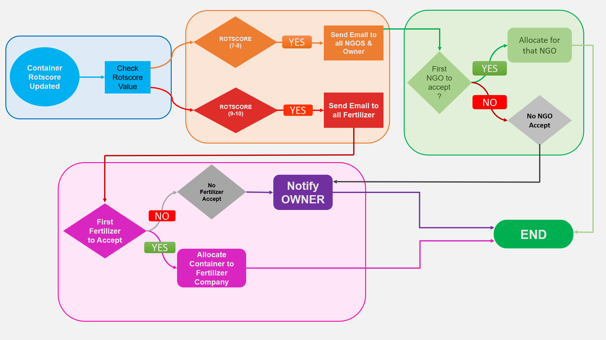
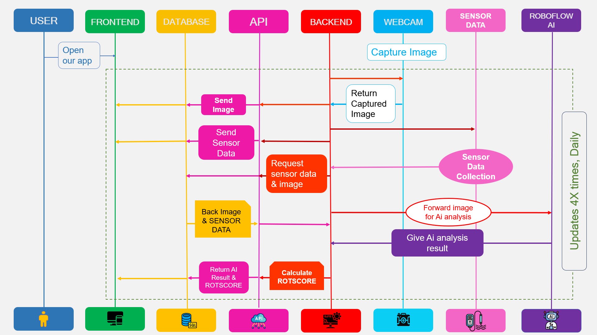

# ROTSPY

**Oracle APEX and IoT produce monitoring system**

ROTSPY is a hackathon prototype that combines environmental sensor readings and webcam based image analysis to help track produce freshness. The project was built by **The Infinity Coders** for INOAUG Xcelerate 2025.

[Watch the ROTSPY demo video on LinkedIn](https://lnkd.in/p/geaZs_vM)

## The problem

Produce can spoil between manual inspections. ROTSPY explores a monitoring workflow that combines sensor data and image analysis to help identify produce that is fresh, nearing spoilage, or spoiled, then route it for sale, donation, or recycling.

## How the workflow operates

1. A user opens the ROTSPY Oracle APEX application.
2. The backend requests produce image and sensor data. A webcam captures the image, while the sensor collection process supplies gas, temperature, and humidity readings.
3. The image is forwarded to RoboFlow AI for analysis. The sequence diagram labels the system updates as occurring four times daily.
4. The backend combines the returned analysis and sensor information to calculate a ROTScore. The result is saved and returned to the application for display.
5. When the ROTScore is updated, the routing workflow sends the item toward an NGO or fertilizer company based on the score bands shown in the diagram.

## Screenshots

### Container overview

### About the project

### Live sensor data

### Sensor trends

### ROTScore history

### Freshness notifications

## System overview

### Data collection and analysis sequence

The sequence diagram shows the app coordinating webcam image capture, sensor readings, image analysis, and ROTScore calculation, with the result returned to the application.

### ROTScore-based routing workflow

The routing diagram shows these branches:

- **ROTScore 7–8:** Email NGOs and the owner. Allocate the item to the first NGO that accepts; if no NGO accepts, notify the owner.
- **ROTScore 9–10:** Email fertilizer companies. Allocate the item to the first company that accepts; if no company accepts, notify the owner.

The provided routing diagram does not show the outcome for other ROTScore values. The screenshots show status labels that vary between views, so confirm the final score-to-status rules before relying on exact thresholds.

## Technologies

- Oracle APEX
- PL/SQL and JavaScript
- REST APIs
- Arduino
- MQ135 gas sensor
- DHT11 temperature and humidity sensor
- Webcam based image capture and AI image analysis

## My role

I led the team and contributed to frontend and backend development.

## Team

The Infinity Coders

## Award

**2nd Place**, INOAUG Xcelerate 2025 Oracle APEX Hackathon.

## Demo

[Watch the demo video on LinkedIn](https://lnkd.in/p/geaZs_vM)

## Repository contents

This repository is a project showcase with screenshots, workflow diagrams, and the demo link. The Oracle APEX application export, Arduino firmware, and deployment configuration are not included here. The APEX link previously used for the project contains a temporary session value, so this repository links to the recorded demo instead.
